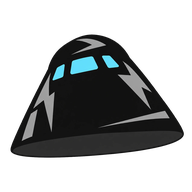

<p align="center">
  
</p>

<h1 align="center">Dragon</h1>

Dragon is a faster linker for Black Ops III maps and mods. It reads the same sources as Treyarch's linker and
builds the same fastfiles, so your project doesn't change; it just links in seconds where the Mod Tools take minutes.

It works beside the stock linker, not instead of it. [Blackbird](https://github.com/Blakintosh/blackbird) links with
Dragon when it's installed, and hands a project to the stock linker for anything Dragon can't link yet.

## What it does

- **Fast.** A link with nothing changed takes under a second and a script edit about half a second, where the stock
  linker takes many seconds to minutes. Only what you changed is rebuilt, and Dragon checks the contents of scripts
  and other small files, not just their dates, so an edit isn't missed.
- **Lua included.** UI Lua is compiled by Dragon itself, with the same output as before. L3akMod isn't required, and
  there's nothing else to install.
- **Big models.** Auto LODs work past the stock 220,000-face limit (up to a million faces), and large models
  decimate several times faster.
- **With [Stock Library](https://github.com/Blakintosh/stocklib-releases),** a map can use any asset from the game
  by name, without copying it into your project. With Ultrasound 1.1, the stock sounds your map uses are carried too.

## Requirements

Windows 10 or 11 (64-bit) and the Black Ops III Mod Tools. Dragon works on its own; the other tools make it better.

Works best with Blackbird.

## Installing

Open **Tools > Components** in Blackbird and choose Install next to Dragon. Or download `dragon-setup.exe` from the
[Releases page](https://github.com/Blakintosh/dragon-releases/releases) and run it. It puts `dragon.exe` into the
game's `bin` folder. To install by hand, unzip `dragon-<version>-win-x64.zip` into the `Call of Duty Black Ops III`
folder.

Dragon finds the Mod Tools from where it's installed. Blackbird tells you when an update is out and installs it for
you. The setup is unsigned, so Windows may ask you to confirm it the first time.

## Using it

In Blackbird, **Tools > Link with Dragon** is on by default once Dragon is installed. Each build's log starts with the
Dragon version, so you can see which linker ran. From a command line:

```
bin\dragon.exe -language english -modsource zm_mymap
```

If Dragon stops with `0x0BB10004`, the game (or another program) has the map's files open. Close it and link again.

## Known limits

- A few things Dragon can't link yet. Blackbird hands those projects to the stock linker, except projects that use
  stock assets or stock sounds, which need Dragon to include them.
- Dragon's zones are not byte-for-byte the stock linker's. Differences are in padding and auto LOD meshes; the content
  is the same.

## Bugs and questions

Please [open an issue](https://github.com/Blakintosh/dragon-releases/issues). Say which Dragon version you have
(`bin\dragon.exe -version`) and paste the start of the build log.
